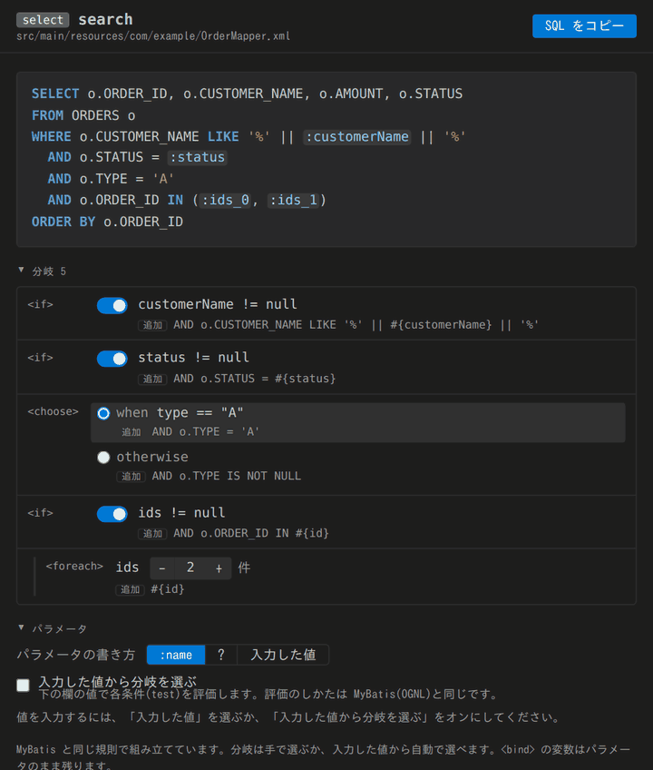
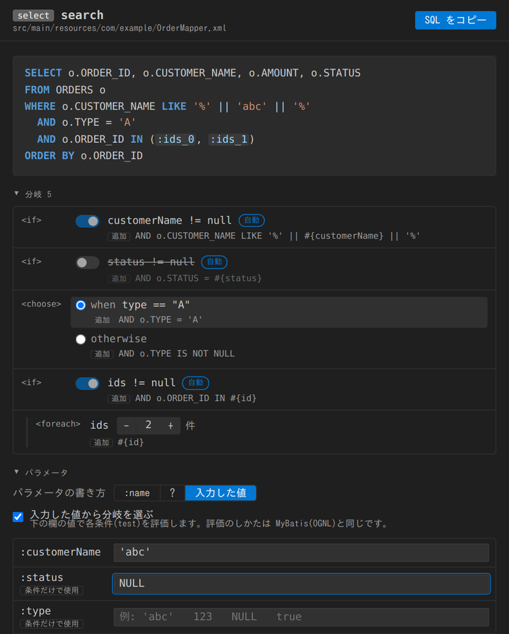
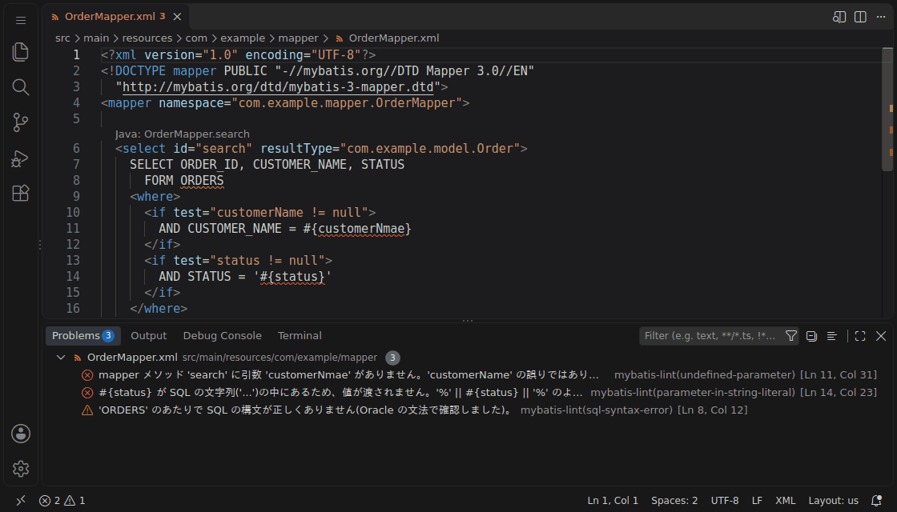

# MyBatis SQL Preview & Lint（プレビュー版）

**動的 SQL が実際にどんな SQL になるかを、実行せずに確認できます。** `<if>` のオンとオフ、`<choose>` の分岐、
`<foreach>` の回数を画面で切り替えると、SQL がその場で変わります。

**保存するたびに mapper XML を静的解析して、実行しないと気づきにくい誤りも見つけます。**

インストールするだけで使えます。Java の準備は不要で、データベースにも接続しません。

> ⚠️ プレビュー版のため、誤検知や検出漏れがあり得ます。結果は参考情報として扱ってください。

この拡張機能は個人が開発しているもので、MyBatis の公式のものではありません。MyBatis プロジェクトとは関係がありません。

## SQL プレビュー

動的 SQL が実際にどんな SQL になるかを、実行せずに確認できます。Markdown のプレビューと同じ感覚で、
mapper XML の statement の中にカーソルを置いて `Ctrl+Shift+V`（Mac は `Cmd+Shift+V`）を押すだけです。
エディタ右上のプレビューボタンからも開けます。



- `<include>`、`<where>`、`<set>`、`<trim>`、`<foreach>` を MyBatis と同じ規則で組み立てます
- `<if>` のオンとオフ、`<choose>` の分岐、`<foreach>` の繰り返し回数を画面で切り替えられます
- パラメータは `:name`、`?`、入力した値のどれかで出力できます。**SQL をコピー** して、DBeaver などの SQL クライアントで
  そのまま試せます

値を入力すると、その値で `test` の条件を評価して、分岐を自動で選ぶこともできます。



## 静的解析

mapper XML や Java ファイルを保存するたびに自動でチェックし、結果を Problems パネルとエディタに表示します。
名前の打ち間違いには、正しい名前の候補とクイックフィックスも出します。



たとえば次のような誤りを見つけます。

| 書いたもの | 見つける内容 |
|---|---|
| `#{userNmae}` | Java の引数やクラスにないパラメータ。近い名前があれば候補を出します |
| `<include refid="missing"/>`、`resultMap="missing"` | 参照先が見つからない |
| `LIKE '%#{name}%'` | 文字列の中に書いたので、値が渡されない |
| `<if test="type == 'A'">` | OGNL では `'A'` が 1 文字扱いになり、String と等しくならない |
| `WHERE` の直後に `<if>` で `AND ...` | 条件によって `WHERE AND ...` になる |
| `SELECT ... FORM USERS` | SQL の構文の誤り（Oracle / PostgreSQL / MySQL） |
| `INSERT` の列と値の数の違い | 列が 4 個なのに値が 3 個、など |
| `id = ${id}` | SQL インジェクションのおそれ |
| Java のメソッドに対応する statement がない | 呼び出すと `BindingException` になる |
| どこからも使われていない `<sql>`、`<resultMap>` | 消し忘れの可能性 |

このほか、statement ID の重複、`parameterType` / `resultType` と Java の型の不一致、resultMap の `property`
の誤りなども確認します。[すべてのルールの一覧](https://github.com/goddch/mybatis-lint#rules)

確実に誤りと判断できないものは、誤検知を避けるため報告しません。コンパイル済みのクラスは読み込まず、
ワークスペース内のソースだけで判定します。

## 編集を助ける機能

- **クイックフィックス**：打ち間違えた名前を、電球アイコンから候補の名前に直せます
- **定義へ移動**（`F12` / `Ctrl+クリック`）：XML の statement と Java のメソッドの間、`<include>` から `<sql>`、
  `resultMap` から `<resultMap>` へ移動できます
- **参照の検索**（`Shift+F12`）と**名前の変更**（`F2`）：id を変えると、参照している箇所もまとめて変わります。
  statement の id を変えると Java のメソッド名も変わります
- **ホバー**：`#{name}` や `resultType` にカーソルを合わせると、Java の型やプロパティを表示します
- **補完**：`#{` の後のパラメータ名、`AS` の後のプロパティ名、`refid` や `resultMap` の id を補完します
- **CodeLens**：`<sql>` や `<resultMap>` の参照数、statement と Java のメソッドへのリンクを定義の上に表示します
- **INSERT の列名ヒント**：`VALUES` の値や `SELECT` の項目がどの列に入るかを、行末に薄く表示します

## 使い方

1. mapper XML を含むフォルダを VS Code で開きます
2. mapper XML や Java ファイルを保存すると、チェックが動きます。すぐに確認したいときは、コマンドパレット
   （`Ctrl+Shift+P` / `Cmd+Shift+P`）で **MyBatis Lint: Check Workspace** を実行します
3. 結果が Problems パネルに表示されます

**Java のインストールは不要です。** 解析に必要な Java ランタイムを拡張機能に同梱しています。

警告文などは VS Code の表示言語に合わせて日本語か英語で表示します（`mybatisLint.language` で固定できます）。

実行ログは **MyBatis Lint: Show Log** で確認できます。チェックを 1 回実行した後に、解析にかかった時間や飛ばしたフォルダなどが
表示されます。うまく動かないときは、このログの内容を不具合の報告に添えてください。

## SQL の構文チェック

違う DB の文法でチェックすると正しい SQL まで誤りになるので、DB が 1 つに決まったときだけチェックします。

1. 設定 `mybatisLint.sqlDialect` で `oracle` / `postgresql` / `mysql` を選んでいれば、その DB
2. statement に `databaseId="oracle"` などがあれば、その DB
3. 既定（`auto`）では、`application.properties` / `application.yml` の JDBC URL、mybatis-config.xml の
   ドライバ、`pom.xml` / `build.gradle` のドライバの依存から推定します。見つからないときや、
   2 つ以上の DB が見つかったときはチェックしません

どの DB としてチェックしたかは **MyBatis Lint: Show Log** に出ます。DB に接続することはありません。

## プライバシー

解析はすべて手元の PC 上で完結します。ネットワーク通信は行わず、ソースコードを外部に送信することもありません。

## 設定

権限がなく読めないフォルダ（Docker のボリュームなど）は、自動的に飛ばして解析を続けます。

| 設定 | 説明 |
|---|---|
| `mybatisLint.runOnSave` | mapper XML や Java ファイルを保存したときに自動でチェックするか（既定はオン） |
| `mybatisLint.exclude` | 解析しないフォルダやファイル。ワークスペースからの相対パスで、`*` や `**` が使えます（例: `docker`、`modules/*/generated`）。`/` を含まない名前は、どの階層のフォルダ名・ファイル名にも一致します |
| `mybatisLint.sqlDialect` | SQL の構文チェックに使う DB（`auto` / `oracle` / `postgresql` / `mysql` / `off`）。既定の `auto` は設定ファイルとビルドファイルから推定します |
| `mybatisLint.language` | 警告文、SQL プレビュー、クイックフィックス、CodeLens の言語（`auto` / `en` / `ja`）。既定の `auto` は VS Code の表示言語に合わせます。ルール ID は英語のままです |
| `mybatisLint.insertColumnHints` | INSERT の列名ヒントの表示（`all` / `differentNames` / `off`） |
| `mybatisLint.codeLens` | CodeLens を表示するか（既定はオン） |
| `mybatisLint.keepAnalyzerRunning` | 解析エンジンを起動したままにして、2 回目以降のチェックを速くするか（既定はオン） |
| `mybatisLint.disabledRules` | 報告しないルール（例: `unknown-select-alias`）。`mybatis-lint/` は省略できます |
| `mybatisLint.javaPath` | 解析に使う Java のパス。空なら同梱の Java を使います |
| `mybatisLint.analyzerJarPath` | 解析エンジンの jar のパス。空なら同梱の jar を使います |

## 特定の箇所だけ警告を止める

問題ではない箇所に警告が出る場合は、その 1 行上にコメントを書くと、次の行の警告を止められます。
ルールを書かなければ、すべてのルールが対象になります。指示とルールは 1 行に書いてください。

```xml
<!-- mybatis-lint-disable-next-line unknown-select-alias -->
```

```java
// mybatis-lint-disable-next-line missing-mapper-statement
```

ファイル全体で止めたいときは、ファイル内のどこかに `mybatis-lint-disable-file` と書きます（ルールの指定は同じです）。
誤検知だと思われる場合は、不具合として報告してもらえると助かります。

## 不具合の報告

[GitHub Issues](https://github.com/goddch/mybatis-lint/issues) へお願いします。

## ライセンス

[Apache License 2.0](https://github.com/goddch/mybatis-lint/blob/main/LICENSE)

同梱している Java ランタイム（OpenJDK）は、OpenJDK 自体のライセンス（GPLv2 + Classpath Exception）に従います。ライセンス文書は拡張機能内の `jre/legal/` に含まれています。
